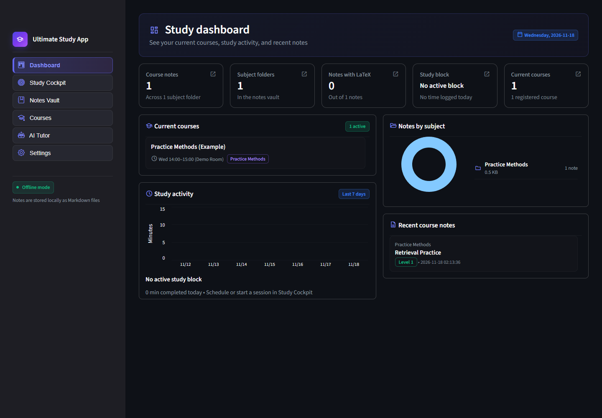
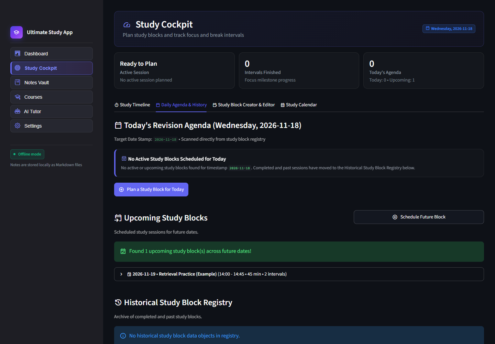
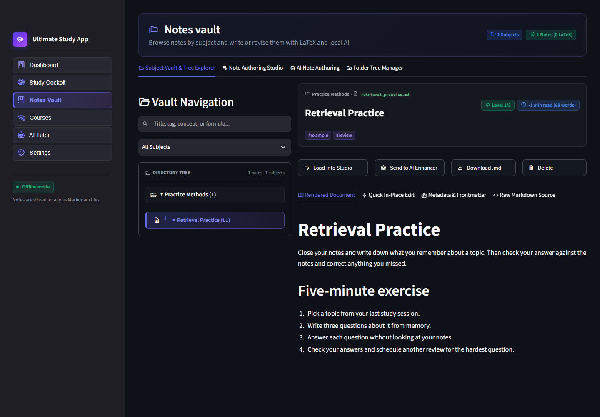

# Ultimate Study App

Ultimate Study App is a local study workspace that connects course planning, timed focus sessions, and Markdown notes. Plan a study block, link the material you want to review, and track your progress from one dashboard. An optional Ollama tutor can use your notes to answer questions and help draft or revise study material.

The planner and Notes Vault work without Ollama or a Wikipedia archive. First launch with default storage creates a fictional course, study session, and note to try.



## What it does

- **Dashboard and courses**. Review active courses, study activity, and recent notes. Manage course details and schedules in the course roster.
- **Study Cockpit**. Plan focus and break intervals, link notes to study sessions, and review scheduled sessions in an agenda or calendar.
- **Notes Vault**. Browse notes by subject, search by title or tag, edit Markdown, and preview formatted text and LaTeX.
- **Local AI tutor and note authoring**. Choose an installed Ollama model for chat and writing assistance. Enable excerpts from your notes and offline Wikipedia as optional context.

<details>
<summary>See the Study Cockpit and Notes Vault</summary>





</details>

## Tech stack

| Area | Technology and role |
| --- | --- |
| Application | Python and Streamlit, with custom CSS and `streamlit-option-menu` for navigation |
| Scheduling | Python scheduling logic for focus intervals, breaks, and saved study sessions |
| Data visualization | pandas and Altair for study activity and note distribution charts |
| Local storage | Markdown with YAML front matter for notes, JSON for courses, sessions, and settings, and SQLite for legacy workflows |
| Optional AI | Ollama HTTP API for tutoring and note authoring with one configurable local model |
| Optional Wikipedia | `libzim` for reading local ZIM archives and FastMCP for the optional MCP server |
| Tests | pytest for scheduling, notes, settings, and workflows |

## Run locally

Install Python 3.14 and clone or download this repository. Run the following commands from the project directory.

**Windows PowerShell**

```powershell
py -3.14 -m venv .venv
.\.venv\Scripts\python.exe -m pip install -r requirements.txt
.\.venv\Scripts\python.exe -m streamlit run src/app.py
```

**macOS and Linux**

```bash
python3.14 -m venv .venv
.venv/bin/python -m pip install -r requirements.txt
.venv/bin/python -m streamlit run src/app.py
```

Open `http://127.0.0.1:8501` in your browser. In **Study Cockpit → Daily Agenda & History**, look under **Upcoming Study Blocks** for the example session scheduled for the next day. Open **Notes Vault** to explore the example note. The default server binds to the loopback interface. Some icons load from Google Fonts.

## Use your own study data

In **Settings → Storage & Backup**, set **Study data folder** to use a different workspace. The folder path can be absolute or relative to this project. Individual overrides can be absolute or relative to the selected study data folder. Blank overrides use these paths:

| Setting | Path inside the study data folder |
| --- | --- |
| Markdown notes folder | `notes/` |
| Courses JSON file | `courses.json` |
| Study sessions folder | `sessions/` |
| Legacy study blocks JSON file | `study_blocks.json` |
| SQLite database file used by the legacy scripts | `notes/study_core.db` |

Switching paths opens the selected data in place. Settings are saved to `data/settings.json`. Set `SETTINGS_FILE` before launch if you want the settings file itself elsewhere. To move an existing study data folder, close the app, move the folder, and update **Study data folder** after restarting. Update any absolute overrides that pointed into the old location.

**Export study data** downloads the active Markdown notes, courses, sessions, and legacy block records. Copy your SQLite database and settings separately if you use them. Keep backups private.

## Optional local AI and Wikipedia

1. Install and start [Ollama](https://ollama.com/download). Download your preferred model with `ollama pull MODEL_NAME`, replacing `MODEL_NAME` with its Ollama name.
2. In **Settings → Local AI & Wikipedia**, set the model name to the one you installed. The default base URL is `http://localhost:11434`. Tutor and authoring prompts can include excerpts from your notes and are sent to the configured endpoint.
3. Leave **Enable offline Wikipedia** off to work without an archive. Also turn off **Use Markdown notes in tutor replies** if you want replies based only on the model. To add offline grounding, install `requirements-wikipedia.txt`, download a suitable archive from the [Kiwix library](https://library.kiwix.org/), enter its path as **Wikipedia ZIM file**, and enable the option. The app reads the ZIM directly. If the file or its reader is unavailable, model and notes features remain available.

To use the optional Wikipedia MCP server, run `python src/wiki_server.py --mcp` with the Wikipedia dependencies installed. `examples/mcp_config.json` shows the command and arguments. Adapt its interpreter and workspace variable to your MCP client. `ZIM_PATH` can supply the archive path for command-line use.

## Tests

```text
python -m pip install pytest
python -m pytest -q
```

The direct Wikipedia integration test needs an English Wikipedia ZIM and `requirements-wikipedia.txt`. The legacy Kiwix HTTP scraper test runs when `RUN_KIWIX_TESTS=1` and a server is available. Set `KIWIX_SERVER` and `KIWIX_ARCHIVE_ID` for a custom server or archive. The core test suite does not need a ZIM or Kiwix server.

## License

Copyright © 2026 Aleksanteri Kuosmanen. Released under the [MIT License](LICENSE).
